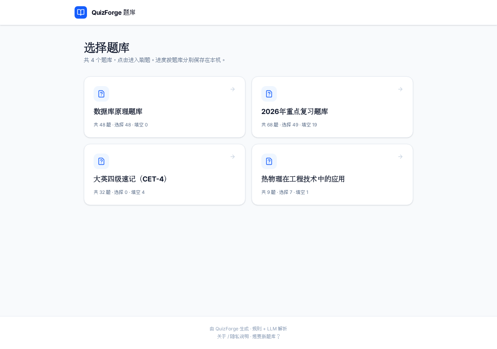
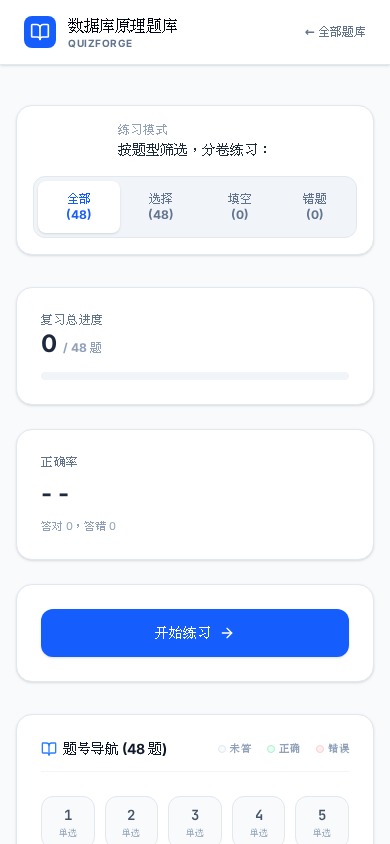
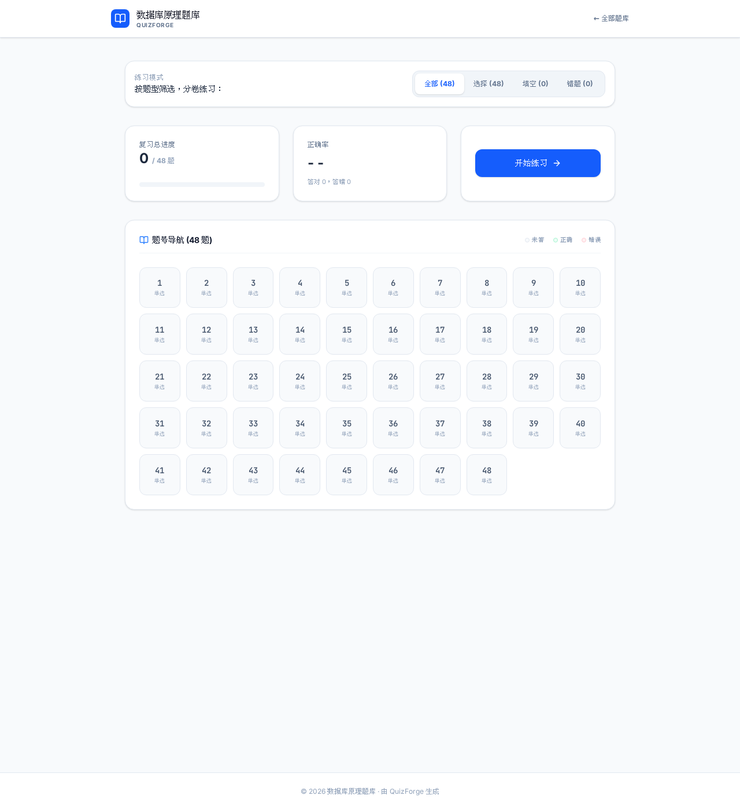

# QuizForge

> 期末选填题速刷：把复习资料变成**能刷题的网页**——只保留「核对答案 + 无限重做」。

[](https://github.com/kkkkikun/QuizForge/actions/workflows/ci.yml)
[](https://github.com/kkkkikun/QuizForge/actions/workflows/deploy.yml)
[](LICENSE)

**🌐 在线刷题**：<https://kkkkikun.github.io/QuizForge/>
**🔬 在线转换（浏览器内，Beta）**：<https://kkkkikun.github.io/QuizForge/convert>



<p align="center">
  
  
</p>

---

## 🙋 我是来刷题的（使用者）

1. 打开上面的**在线刷题**链接，选择题库卡片进入
2. 单选点选即判，多选/填空提交核对；答错的题进「错题」卷可反复重刷
3. 手机上体验最好：可以左右滑切题、加到主屏幕离线刷（PWA）
4. 进度只存在**你自己的设备**上，不注册、不上传、无统计（[隐私说明](https://kkkkikun.github.io/QuizForge/about)）

**发现题目有错？** 刷题页每道题下方有「这道题有问题？」按钮，点开就是预填好的反馈表单。
**想要新题库？** [提一个 Issue](https://github.com/kkkkikun/QuizForge/issues/new?template=new-quiz.yml)（或把 Word/PDF 复习资料发给站长）。

**手上有资料、想立刻自己转？** 用上面的**在线转换**：选一个 `.docx`/`.txt`，在**你自己的浏览器里**解析成题库网页下载——文件全程不上传（纯前端，离线可用）。也可以用下面的命令行版本。

---

## 🔧 我想自己跑（命令行 / 开发者）

三段管线，层间用「题库 JSON」数据契约解耦：

```
 .docx/.pdf/.txt  ──▶  摄取  ──▶  Block 流  ──▶  解析  ──▶  Quiz JSON  ──▶  渲染  ──▶  单文件 HTML / React 站
                     python-docx     规则优先                     题库 JSON 内嵌      React 多题库（Pages）
                     pdfplumber      + LLM 兜底（可选）
                                     + 滤噪 + 答案区映射
```

需要 Python ≥ 3.10，推荐 [uv](https://docs.astral.sh/uv/)：

```bash
git clone https://github.com/kkkkikun/QuizForge && cd QuizForge
uv sync

# 纯规则解析（无需任何 API key），生成双击即开的单文件 HTML
uv run quizforge ./data/数据库原理题库.docx

# LLM 增强（可选）：.env 填 key 后，给规则判不定的题补答案
uv run quizforge ./data/2026年重点复习题库.docx --json --max-llm 70

# 解析出问题？打印文档结构诊断（分节/候选/滤噪）
uv run quizforge 怪文档.docx --diagnose

# 跑测试（含真实样本回归门禁 + 发布校验关卡）
uv run pytest
```

### 命令行参考

| 选项 | 说明 |
|------|------|
| `input` | `.docx`/`.pdf`/`.txt`（解析）或 `.json`（从已存题库重渲染） |
| `-o, --output` | 输出 HTML 路径 |
| `--no-llm` / `--max-llm <N>` | 强制纯规则 / LLM 调用上限 |
| `--llm-parse` | 整篇交 LLM 结构化（怪文档兜底，产出标存疑） |
| `--review` | 逐题核对存疑题（`y`确认 / `a`改答案 / `s`跳过 / `d`删除） |
| `--diagnose` | 打印文档结构诊断 |
| `--json` | 同时导出题库 JSON |
| `--react-frontend <DIR>` | 多题库模式：读 `<DIR>/quizzes.yaml` 生成 `src/data.ts` |

### 把自己的题库挂到站点

```bash
# 一条龙：复制文档入 data/ → 登记 quizzes.yaml → 生成 data.ts（过校验关卡）→ 给出提交命令
uv run python scripts/add_quiz.py 同学的计网复习.docx --id network --title 计算机网络期末
```

前端（React 19 + Vite + Tailwind v4 + PWA）是独立子工程：`cd frontend && npm install && npm run dev`。

### 质量把关（三道关）

1. **结构校验**（自动）：题干/选项/答案合法性，不合规标存疑 ⚠️
2. **发布校验关卡**（自动，`quizforge/validate.py`）：重复题、答案越界、空组等 error 级问题**拒绝生成**（CLI 退出码 4）
3. **人工核对**（`--review`）：只过存疑题

### 开发约定

- **TDD**：先测后码；`data/*.docx` 是回归基线，新文档入库即自动受检（`tests/test_validate.py` 扫 `data/` 全量）
- **数据契约**：Quiz JSON 是层间唯一中间表示（`openspec/changes/quizforge-mvp/design.md §3.2`）
- 文档体系：`CLAUDE.md`（索引）→ `.claude/docs/`（roadmap / SNAPSHOT / tasks）→ `openspec/specs/`
- 提交规范：不加 `Co-Authored-By`

## 📦 作为 Python 包安装（Beta）

```bash
pip install quizforge-cli   # 或 uv tool install quizforge-cli；安装后命令为 quizforge
```

> 注：PyPI 分发名 `quizforge` 已被他人占用，故用 `quizforge-cli`（导入包名/命令名不变）。发布前可 `pip install git+https://github.com/kkkkikun/QuizForge`。

## ⚠️ 已知限制

- 题目图片/图表不抽取（占位丢弃）；扫描版 PDF 需先 OCR
- LLM 答案是其推理结果（文档无答案 key 时）；标准课程知识可靠，冷门题可能偏差
- 在线转换（浏览器版）目前支持 `.docx`/`.txt`，PDF 请用命令行版

## 🗺 路线图

- [x] jsdom/vitest 前端测试、移动端优先 + PWA、错题本与反馈通道
- [x] 答案 key 区映射（文末「参考答案」按题号回填，免 LLM）；解析诊断 `--diagnose`
- [x] 浏览器端在线转换（Pyodide，纯规则，文件不上传）
- [ ] 图片抽取、扫描 PDF OCR、十五选十（待格式样本）
- 完整推广路线见 [.claude/docs/roadmap.md](.claude/docs/roadmap.md)

## 🤝 贡献

欢迎 Issue / PR。较大改动走 OpenSpec 变更流程（`openspec/`）。MIT 协议。
